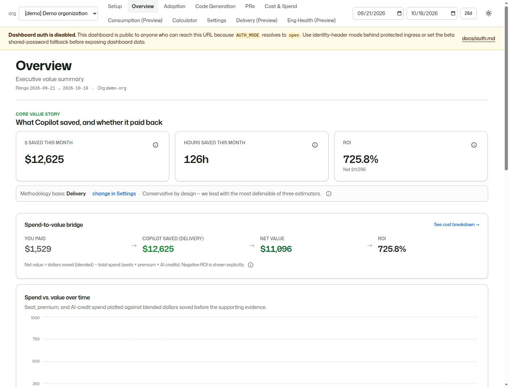
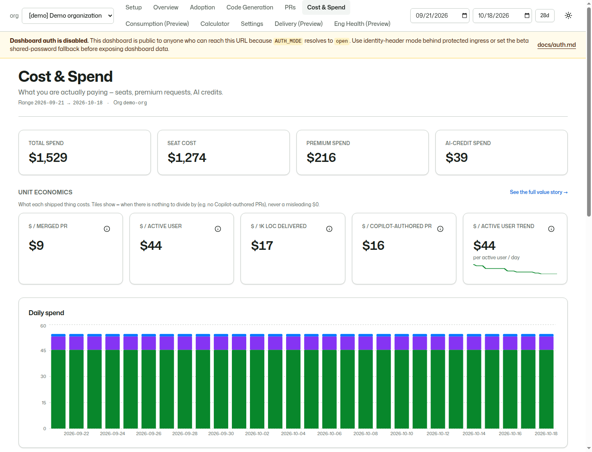
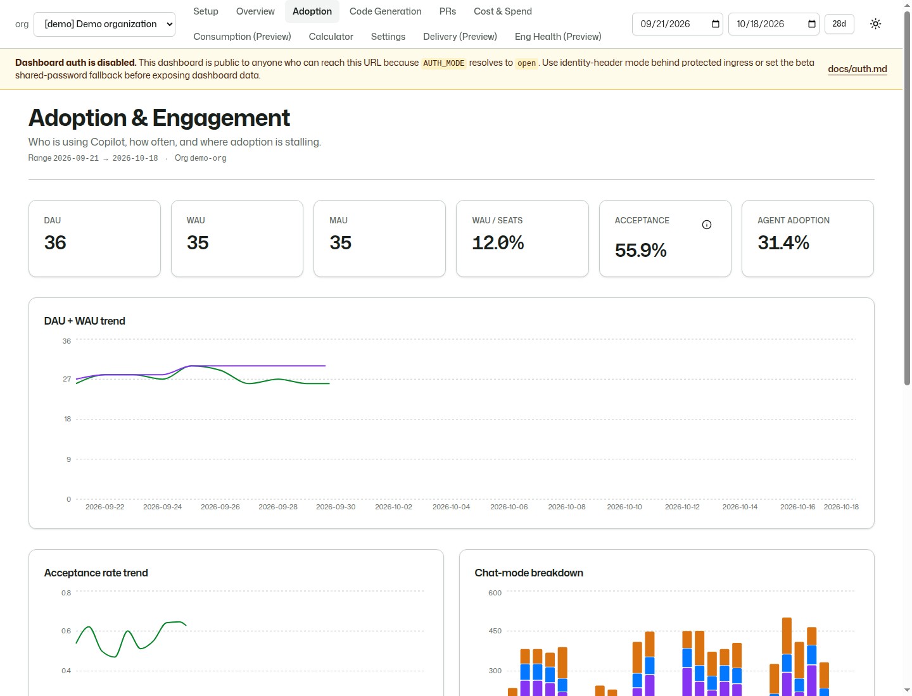

```text
    .----------------------------------------------------------.
    |             COPILOT METRICS DASHBOARD                     |
    |                                                          |
    |   [ Usage ] ----.                                        |
    |                 +--> [ Evidence ] --> [ Value* ]          |
    |   [ Spend ] ----'         |                |              |
    |                       _/\/\__        [ Next action ]      |
    '----------------------------------------------------------'
            YOUR DATA. VISIBLE MATH. BETTER DECISIONS.
                         * Estimates, not guarantees
```

# GitHub Copilot Metrics Dashboard

> Turn Copilot usage and spend into an auditable value conversation.

[](./specs/08-launch-readiness-and-priorities.md)
[](./.github/workflows/ci.yml)
[](./LICENSE)

Engineering leaders and finance partners need to understand whether their Copilot investment is being adopted and where it may create value. Usage, spend, and delivery signals are difficult to assemble into a consistent business discussion, while savings claims often rely on opaque assumptions. This customer-hosted build brings those signals together with transparent, adjustable estimates of time saved, dollar value, and ROI. It helps stakeholders agree on assumptions and choose an adoption action without ranking individual developers or treating usage as proof of productivity.

**Audience:** engineering leaders and developer-productivity leads, supported by platform engineers, finance partners, and SEs/CSAs. **Customer/industry:** reusable, cross-industry. **Positioning:** an OSS beta demo/evaluation accelerator, not an official catalog acceptance, Microsoft support commitment, or production-readiness claim.

## Start here

| Your goal | Start here |
| --- | --- |
| Run without GitHub credentials | [Local demo](#demo-mode--no-github-credentials) |
| Present the customer story | [Demo scripts](#demo-scripts) and [screenshots](#screenshots) |
| Evaluate approved organization data | [Onboarding](./docs/onboarding.md) |
| Adapt for a customer | [Reuse guide](#reuse-and-customization) and [pilot template](#customer-engagement-and-pilot-template) |
| Assess Azure hosting | [Deployment guidance](#azure-p1-foundation) and [P1 readiness gates](./specs/08-launch-readiness-and-priorities.md) |
| Prepare a catalog submission | [Draft metadata](./accelerator.yaml) and [sharing checklist](#before-sharing-or-submitting) |

## What this build does

1. **Retained reporting history** through daily collection, with backfill limited to source availability.
2. **Value translation** from usage to time saved and dollars saved using transparent, tunable assumptions.
3. **Cost-aware ROI** across seats, premium requests, and AI-credit spend.
4. **Delivery evidence** from PR metrics already exposed by the Copilot Metrics API.
5. **Standalone calculator** for quick what-if savings estimates without GitHub API access.

The supported starting point is your own local synthetic demo, not a maintainer's live cloud environment. Savings are assumption-based estimates, not realized cash savings or causal proof of productivity.

## Status: P0 OSS Beta

This repository is in **P0 — OSS Beta / core value-story launch** for a trustworthy local/demo and org-scope real-data experience across the P0 views. See [`CHANGELOG.md`](./CHANGELOG.md) for beta release notes. Do **not** treat the project as production self-host ready until the **P1** gates in [`specs/08-launch-readiness-and-priorities.md`](./specs/08-launch-readiness-and-priorities.md) pass, including production-credible auth, Azure deployment artifacts, observability, backup/restore, and runbooks.

| Capability | Readiness |
| --- | --- |
| Demo seed, Postgres storage, collector, and value engine | P0 core |
| Overview, Cost & Spend, Adoption, Code Generation, Pull Requests, Calculator, Settings | P0 first-class views when populated and explained |
| Delivery Velocity and Engineering Health | P1 preview/advanced only; not P0 launch blockers |
| Enterprise-scale rollups/cost centers, Tickets/GitHub Issues, Teams, GitHub App source auth, AzDO/Jira/Linear, Fabric/OneLake, Power BI, GHAS/Security, forecasting/anomaly detection | P2 expansion; hidden/planned until readiness gates pass |

Beta limits to keep in mind:

- Shared-password dashboard auth is a **beta fallback**, not RBAC, OAuth, or a production access model.
- Preview/advanced views may exist for exploration, but only the P0 views above define OSS beta readiness.
- P1 production self-host guidance is intentionally gated on hardened auth, health/observability, backup/restore, and runbooks.
- Deferred P2/polish items in spec 08 include DORA/CI gold completion, p90 lead-time/commit stats, richer agent-session source signals, screenshots/demo GIFs, issue-template config polish, Teams/Tickets, external trackers, Fabric/OneLake, GHAS/Security, and forecasting/anomaly detection.

### P1 production self-host readiness materials

Use this index when evaluating the production self-host path. These are P1 hardening artifacts, not a claim that P1 gates have passed; [`specs/08-launch-readiness-and-priorities.md`](./specs/08-launch-readiness-and-priorities.md) remains the readiness authority.

| Material | Use it for | Current caveat |
| --- | --- | --- |
| [`docs/auth.md`](./docs/auth.md) | Dashboard access posture, Microsoft Entra built-in auth setup, the exposure-based "do you need auth?" guide, and secret rotation. | Native in-app OAuth/RBAC is not built; Entra EasyAuth (identity-header) is the recommended production path and shared-password is a fallback. |
| [`docs/observability.md`](./docs/observability.md) | `/api/health`, collector run status, the provisioned Azure Monitor alert catalog, and Log Analytics queries. | Alerts and the availability test are provisioned behind `enableAlerts` / `enableAvailabilityTest`; tune thresholds and receivers per environment. |
| [`docs/production-runbook.md`](./docs/production-runbook.md) | `azd` deployment, upgrades, daily collection, backfill, backup/restore, and incident response. | A clean tagged-release deployment and a completed restore rehearsal remain P1 validation gates. |
| [`docs/restore-rehearsal.md`](./docs/restore-rehearsal.md) | Step-by-step Postgres PITR + bronze replay/backfill drill (scripts in `scripts/restore/`) plus a non-production evidence template. | A completed, reviewed rehearsal record is still required before checking off P1 restore readiness. |
| [`infra/bicep/README.md`](./infra/bicep/README.md) | Azure Bicep foundation (Container Apps, Postgres, Key Vault, Log Analytics, bronze storage, Entra auth, alerts) deployable via `azd`. | Single-region; DB role bootstrap is automated by the `azd` postprovision hook, but private networking and a validated tagged rollout remain hardening work. |

## Screenshots

Screenshots below use synthetic `demo-org` data, captured on 2026-10-18 in local open-auth mode. Values are illustrative estimates, not customer results. See [`docs/images/README.md`](./docs/images/README.md) to regenerate all six demo views.





Additional captures: [Code Generation](./docs/images/code-generation.png), [Pull Requests](./docs/images/pull-requests.png), and [Calculator](./docs/images/calculator.png).

## Architecture

```
┌──────────────────┐    ┌──────────────────┐    ┌──────────────────┐
│  collector       │───▶│   Postgres       │───▶│   web (Next.js)  │
│  (Node CLI)      │    │   lakehouse-     │    │   shadcn + ts-   │
│                  │    │   shaped facts   │    │   rest contracts │
│  • Metrics API   │    │   + dimensions   │    │                  │
│  • Billing API   │    │                  │    │   P0 views       │
│  • AI Credits    │    │                  │    │   + calculator   │
└──────────────────┘    └──────────────────┘    └──────────────────┘
```

Built as a [pnpm](https://pnpm.io) monorepo:

- **`apps/web`** — Next.js 15 dashboard and calculator.
- **`apps/collector`** — Node CLI for daily ingestion, backfill, seeding, gold rebuilds, and Parquet export.
- **`packages/contracts`** — ts-rest API contracts shared by web and collector code.
- **`packages/db`** — Drizzle ORM schema, migrations, and seed scripts.
- **`packages/value`** — pure value-translation engine for hours, dollars, ROI, and estimator blending.

## Quick start

### Demo mode — no GitHub credentials

Prerequisites: **Node.js 20 or 22**, **pnpm 10.33.0** (the version pinned in `package.json`), Docker with Compose, and available ports 3000, 5432, and 8080. Run commands from the checkout root. Enable Corepack if pnpm is unavailable (`corepack enable` where Corepack is installed).

```bash
pnpm install --frozen-lockfile
test -f .env || cp .env.example .env
pnpm infra:up
pnpm smoke:demo                  # build value + migrate + seed + verify synthetic data
pnpm web
# Open http://localhost:3000
```

Use a dedicated demo database, not a customer database. Check `.env` points to the local Compose Postgres database before running migrations/seeding. Leave `GITHUB_TOKEN` empty for this demo-only environment. Local Compose credentials are development-only; do not expose Postgres or Adminer to untrusted networks.

**Expected outcome:** select **demo-org**, then see populated Overview, Cost & Spend, Adoption, Code Generation, and Pull Requests views. Calculator works independently; Settings explains assumptions. `pnpm smoke:demo` verifies both stored facts and dashboard queries without calling GitHub. For production-style serving, run `pnpm build` before `pnpm --filter @ghcp-dash/web start`; `start` does not build the app.

The seed covers 90 synthetic days; this is not a promise of 90 days of historical customer API data. Re-run `pnpm smoke:demo` before presenting to refresh the demo reporting window.

### End-to-end customer journey

1. **Request:** agree the decision: improve adoption, evaluate spend, or gather evidence before expansion.
2. **Context:** identify the sponsor, organization, available reporting dates, billing permissions, privacy rules, and accepted assumptions.
3. **Workflow:** demonstrate synthetic data first; for an approved evaluation, validate collector access, ingest a short supported window, and check freshness/source coverage.
4. **Evidence:** review adoption, PR signals, costs, and estimator inputs for the same organization/date range.
5. **Output:** record a value hypothesis with conservative/base assumptions and explicit missing data. Do not interpret correlation as causality.
6. **Next action:** agree one enablement intervention or pilot, its owner, acceptance criteria, and review date.

### Safe real-account onboarding

Use [`docs/onboarding.md`](./docs/onboarding.md) or the in-app `/getting-started` page when testing with someone's GitHub organization. The recommended flow is:

1. Prove the app locally with demo data.
2. Create a short-lived classic PAT for an approved org owner, billing manager, or Copilot admin.
3. Validate `.env` with `pnpm smoke:collector-config`.
4. Validate DB connectivity and token scopes with `pnpm --filter @ghcp-dash/collector exec tsx src/index.ts collect --check`.
5. Backfill a small completed UTC date range with `pnpm collect:backfill --from <yyyy-mm-dd> --to <yyyy-mm-dd> --concurrency 1`, then expand once the dashboard looks right.

The GitHub token belongs only in the collector environment. The web app must not receive outbound GitHub credentials.

### Real-data mode

Set `GITHUB_TOKEN` and `GITHUB_ORGS` in `.env`, then run:

```bash
pnpm db:migrate                  # creates/updates Postgres tables
pnpm db:seed                     # production-safe dims + settings, including pseudonym_salt
pnpm smoke:collector-config      # validates required env without calling GitHub
pnpm collect                     # pulls the supported baseline window
pnpm web
```

`GITHUB_ENTERPRISE` exists for preview validation of enterprise endpoint variants with a classic PAT, but the P0 beta readiness claim is org-scope unless the release notes explicitly say otherwise.

To backfill historical data:

```bash
pnpm collect:backfill --from 2025-10-10 --to 2026-06-19
```

Replace those example dates with completed UTC days inside the currently supported API window; older requests can be clamped and unavailable history cannot be recreated.

## Optional dashboard auth

`AUTH_MODE` controls inbound dashboard access:

- unset: backward-compatible default — `shared-password` when `DASHBOARD_PASSWORD` is set, otherwise `open`.
- `open`: no dashboard auth; pages show an auth-disabled banner and Settings mutations are rejected.
- `shared-password`: beta fallback using `DASHBOARD_PASSWORD` and a signed, `httpOnly`, `sameSite=lax` cookie (`secure` in production) with a 12-hour max age.
- `identity-header`: production-credible app mode for Azure Easy Auth / Entra ID / identity-aware proxies. The app trusts only the configured upstream header (`AUTH_IDENTITY_HEADER`, default `x-ms-client-principal-name`) and does not validate OAuth tokens itself.

`/getting-started`, `/calculator`, `/login`, `/api/auth/login`, `/api/auth/logout`, and `/api/health` stay public in protected modes. Shared-password auth remains a beta safeguard, not production RBAC/OAuth. In identity-header mode, upstream must authenticate users, strip spoofed client headers, inject the trusted identity header, and enforce any viewer/admin separation for Settings until native dashboard RBAC exists. See [`docs/auth.md`](./docs/auth.md).

## P0 validation and health

| Command | What it checks |
| --- | --- |
| `pnpm smoke:migrate` | Applies migrations against the configured Postgres database. |
| `pnpm smoke:demo` | Runs migrations, seeds `demo-org`, and verifies demo data covers P0 views. |
| `pnpm smoke:collector-config` | Validates collector env (`GITHUB_TOKEN` plus `GITHUB_ORGS`, or preview `GITHUB_ENTERPRISE`) without calling GitHub. |
| `pnpm smoke:p0` | Runs collector config smoke plus demo smoke. |
| `pnpm ci:p0` | Local CI parity: typecheck, lint, test, build, and P0 smoke. |

`pnpm smoke:p0` and `pnpm ci:p0` need collector config values. For config-only smoke without real GitHub credentials, use placeholders:

```bash
GITHUB_TOKEN=ci-placeholder-token GITHUB_ORGS=demo-org pnpm smoke:p0
```

The web app exposes a public health endpoint for local checks and future P1 probes:

```bash
curl http://localhost:3000/api/health
```

For health probe behavior, collector run status, alert recommendations, and example Log Analytics queries, see [`docs/observability.md`](./docs/observability.md).

## Azure P1 foundation

A single-region Bicep foundation lives in [`infra/bicep`](./infra/bicep/). The verified clean-environment flow validates with `azd provision --preview --no-prompt`, provisions with `azd provision --no-prompt`, then deploys with `azd deploy --no-prompt` so Container Apps and ACR RBAC can propagate before image builds and pushes. It provisions Container Apps web/collector workloads, Postgres Flex, Key Vault, Log Analytics, managed identities, durable bronze storage, optional Microsoft Entra built-in auth (`enableEntraAuth`), and optional Azure Monitor alerts (`enableAlerts`) plus an `/api/health` availability test (`enableAvailabilityTest`). An `azd` postprovision hook bootstraps least-privilege database roles, runs migrations, and verifies grants. It is a P1 hardening artifact, not a production-readiness claim; review [`infra/bicep/README.md`](./infra/bicep/README.md) and [`docs/production-runbook.md`](./docs/production-runbook.md) before deploying.

## Seed reference

The Drizzle seed script is idempotent for dimensions and safe for real-data databases by default. It never touches fact data unless explicitly asked.

| Command | What it does |
| --- | --- |
| `pnpm db:seed` | Dimensions + default settings. |
| `pnpm db:seed:demo` | Dimensions/settings + 90 days of synthetic `demo-org` data. |
| `pnpm db:seed:clear-demo` | Removes only demo data. Real orgs are untouched. |
| `pnpm db:seed:reset` | **Dangerous:** wipes all fact tables and ingestion runs. Keeps dimensions/settings. |

## Value translation methodology

Every dollar figure is computed from explicit, configurable knobs. The Settings page lets admins tune them, and derived metrics link to "How is this calculated?" explanations.

Three estimators run side-by-side:

1. **Activity-based** — accepted completions, chat, and agent-session activity.
2. **Output-based** — Copilot-attributed output as a directional sanity check.
3. **Delivery-based** — Copilot-authored and Copilot-reviewed PR evidence from the Metrics API.

Dollar conversion = `time_saved_hours × avg_loaded_eng_cost_per_hour`.

ROI = `(dollars_saved − seat_cost − premium_spend − ai_credit_spend) ÷ total_spend`.

**Default headline:** the blend is 100% Delivery. Missing delivery evidence can produce a zero headline despite other activity. Inspect all three estimators before drawing a conclusion; generated lines are directional, not a standalone productivity measure.

**Changing assumptions:** use Calculator for immediate what-if discussion. Saving Settings does not itself guarantee a recomputation. After an authorized save, run `pnpm --filter @ghcp-dash/collector exec tsx src/index.ts gold` in the collector environment (or wait for its scheduled rebuild), then refresh and inspect the persisted knob snapshot. Open auth mode intentionally rejects Settings changes.

Future issue/ticket, team, tracker, Fabric/OneLake, GHAS/Security, and forecasting/anomaly work is P2 unless promoted by the launch-readiness spec.

## Demo scripts

### Presenter preflight

- Use a dedicated synthetic-only database and run `pnpm smoke:demo`.
- Synthetic seeding does not record real ingestion runs; `/api/health` can report freshness as `unknown`. This does not validate the GitHub ingestion pipeline.
- Open the P0 views, select `demo-org`, and confirm the reporting range overlaps seeded dates.
- Keep the same organization and dates throughout. Check charts finish rendering before presenting.
- Show the auth-disabled warning honestly in local open mode. Do not imply that the demo configuration is suitable for customer hosting.
- Keep [screenshots](#screenshots) available if the local runtime fails. They are fallback assets, not live verification.

### Five-minute demo

| Time | Screen / action | Talk track |
| --- | --- | --- |
| 0:00–0:40 | Frame the request; identify synthetic data | “What does Copilot cost, what value might it create, and can we inspect that estimate?” |
| 0:40–1:40 | Overview | Show reporting period, value, spend, ROI, and estimator basis; do not promise a fixed number. |
| 1:40–2:30 | A metric's calculation explanation | Trace one estimate to its inputs and assumptions. |
| 2:30–3:30 | Adoption, then Pull Requests | Connect activity and delivery evidence without causal claims or individual rankings. |
| 3:30–4:20 | Cost & Spend | Explain seat/premium/AI-credit costs and unavailable values. |
| 4:20–5:00 | Calculator and next action | Change one assumption; propose a scoped customer evaluation. |

### Fifteen-minute demo

| Time | Screen / action | Intended outcome |
| --- | --- | --- |
| 0:00–2:00 | Customer question, scope, synthetic-data disclosure | Shared decision and privacy boundaries |
| 2:00–5:00 | Overview and calculation explanations | Auditable value hypothesis |
| 5:00–8:00 | Adoption, Code Generation, Pull Requests | Evidence and signal limitations |
| 8:00–10:00 | Cost & Spend | Agreed cost denominator and missing-data caveats |
| 10:00–12:00 | Calculator; explain Settings/rebuild | Conservative/base sensitivity discussion |
| 12:00–14:00 | Architecture and onboarding | Credential boundary, identity requirements, and deployment gates |
| 14:00–15:00 | Pilot proposal | Named sponsor, next action, and review date |

**Demo acceptance:** another SE/CSA can run the quickstart; all demonstrated P0 views populate; the viewer can reproduce one estimate; unavailable inputs are not presented as zero; only synthetic identities appear; the meeting ends with an agreed action. Positive ROI is not an acceptance requirement.

**Recording recipe:** follow the five-minute script with captions and the synthetic-data label visible; show one calculation explanation and one Calculator change. Review the recording for browser-profile details, tokens, organization names, and cloud identifiers before publishing. A recorded video and independent presenter rehearsal remain sharing-checklist items, not implied completed assets.

## Reuse and customization

| Reuse unchanged | Customize for each engagement |
| --- | --- |
| Dashboard P0 views and Calculator | Customer decision, organization, reporting dates, currency |
| Three-estimator value engine | Loaded engineering cost, savings assumptions, blend weights |
| Collector, validation, and synthetic seed | Approved access, source scope, schedule, retention |
| Bronze/silver/gold and contract-first patterns | Identity, networking, capacity, secrets, operational ownership |
| Local setup, Azure foundation, runbooks | Subscription/region, alerts, recovery evidence, budget, teardown |

**Fork checklist:** update repository/bugs/homepage metadata in root and workspace manifests, accelerator metadata, security-reporting destination, workflow deployment settings, and documentation links. Keep license/attribution and the Constitution. Re-run validation before publishing your adapted build.

**Public assets:** use synthetic data only. Scrub org/repository names, user identities, customer billing, tenant/subscription/resource identifiers, logs, exports, and browser-profile details. Pseudonymization is not anonymization; bronze payloads and database rows can still contain confidential data. Do not upload customer data to public issues or catalog assets.

### Customer engagement and pilot template

**Account-team opener:** “Could we help engineering and finance agree what your Copilot usage signals mean, what it costs, and which adoption action to take next—with assumptions everyone can inspect?”

**Discovery questions**

1. What decision must this evaluation support, and who owns it?
2. Which organizations, reporting dates, and billing signals are approved and available?
3. Which assumptions would finance accept or challenge?
4. What privacy, access, retention, and deployment requirements apply?
5. What intervention could you take if adoption appears uneven?
6. Who will operate the evaluation and support the resulting deployment?

**Workshop offer:** a Copilot Value Evidence Workshop to agree the decision, source inventory, assumptions, privacy boundaries, and pilot acceptance criteria.

Copy this brief into your engagement's approved collaboration space:

| Pilot field | Complete with the customer |
| --- | --- |
| Decision / sponsor | Decision to make; engineering sponsor and finance reviewer |
| Scope / access | One approved organization, available UTC dates, required scopes, data owner |
| Assumptions | Conservative/base cost and estimator settings; reviewer and approval date |
| Intervention | One enablement action; accountable owner |
| Evidence | Source coverage, freshness, spend completeness, reproducible estimates, caveats |
| Success | Stakeholder-approved interpretation and action; not a required positive ROI |
| Review / cleanup | Review date, retention agreement, token revocation, environment teardown owner |

**Findings handoff:** record the tested revision, org/date scope, observed inputs, assumptions, unavailable sources, estimate range, limitations, recommendation, owner, and next review. Keep customer findings outside this public repository.

**CTA:** “Can we bring your Copilot admin, engineering sponsor, and finance partner together to agree one decision, one organization, and the evidence needed for a pilot?”

## Troubleshooting and cleanup

| Symptom | Next check |
| --- | --- |
| pnpm unavailable | Install/enable pnpm matching `packageManager`; see prerequisites above. |
| Database connection fails | Docker health, port 5432, and `.env` database URL; do not print credentials in shared logs. |
| Missing value package declarations | Run `pnpm --filter @ghcp-dash/value build`; root `pnpm typecheck` and `pnpm smoke:demo` include this prerequisite. |
| No orgs or empty charts | Run demo smoke against the intended DB; check org selection and reporting dates. |
| Spend unavailable | Billing permission, available source data, and matching reporting period. |
| Zero estimated headline savings | Delivery-only default and available PR evidence; inspect estimator basis. |
| Settings rejected or values unchanged | Auth mode; authorized save followed by a collector gold rebuild. |
| Production `start` fails | Run `pnpm build` first; use `pnpm web` for local development. |

`pnpm db:seed:clear-demo` removes demo data; `pnpm infra:down` stops the local stack but retains its database volume. Neither command removes customer bronze files, exports, backups, or cloud resources. Follow the agreed retention policy and the [production runbook](./docs/production-runbook.md) for customer/cloud cleanup, including temporary-token revocation. Never use `db:seed:reset` against customer data.

## Before sharing or submitting

The [accelerator.yaml](./accelerator.yaml) is a project-owned draft, **not** a validated official Accelerator Catalog schema. Confirm the receiving catalog's requirements and accountable submission owner before adapting/submitting it.

### Local validation evidence

Rehearsed on **2026-10-18**, revision `535ad0765afac86ee1d2d4c15374b3f368af9e2b`, with Node **22.23.3**, pnpm **10.33.0**, and a fresh PostgreSQL **16** Compose database:

- Frozen dependency installation, root typecheck, workspace lint, and workspace build passed.
- **141 tests passed; one pre-existing test remained skipped**, including successful database-backed dimension-concurrency tests.
- Fresh migrations, 90-day demo seed, demo fact/query smoke, and placeholder-only collector configuration smoke passed.
- Both web and collector Docker build smoke commands passed (Node 20 Alpine images).
- Production `/api/health` reported database readiness `ok`; all seven P0 routes returned HTTP 200.
- `pnpm audit --prod --audit-level=low` reported **no known vulnerabilities**, without the previous CVE waiver.
- Project metadata/relative asset links resolved and changed-file secret scans found no secrets.

This is local synthetic-data evidence, not a GitHub Actions result, live customer ingestion test, Azure deployment certification, full-history security audit, or production endorsement. Installation still reports an existing ts-rest/Next peer-range warning and skipped dependency lifecycle scripts; the checks above passed without relaxing those safeguards. Revalidate on the revision you intend to share.

- [x] Record a tested revision and clean-install/demo results (see local evidence above).
- [x] Verify typecheck, lint, tests, build, migrations, collector config, and demo smoke locally.
- [ ] Rehearse the script with an SE/CSA who did not author the build.
- [ ] Review screenshots; publish a captioned synthetic-only recording if required.
- [ ] Complete the [security prerelease checklist](./docs/security-prerelease-checklist.md), including history review, credential rotation, and repository settings.
- [ ] Confirm support/security destinations and owner; forks must update their own metadata.
- [ ] Agree workshop/pilot scope, acceptance measures, and teardown ownership.
- [ ] Validate metadata against the actual catalog schema; do not claim Microsoft certification or production readiness.

Documentation, sample data, and deployment artifacts are reusable now; catalog acceptance and production readiness require separate evidence and approval.

## Why "lakehouse-shaped" Postgres?

P0 uses Postgres for a fast, self-hostable dashboard. The schema is intentionally fact/dimension shaped across bronze → silver → gold layers so a later P2 Fabric/OneLake writer can mirror the model without rewriting the core value engine.

## Community, support, and security

- Read [`CONTRIBUTING.md`](./CONTRIBUTING.md) before opening a pull request; PRs use the [pull request template](./.github/PULL_REQUEST_TEMPLATE.md).
- Use the issue templates for [bug reports](./.github/ISSUE_TEMPLATE/bug_report.yml), [feature requests](./.github/ISSUE_TEMPLATE/feature_request.yml), and [documentation gaps](./.github/ISSUE_TEMPLATE/documentation.yml).
- See [`SUPPORT.md`](./SUPPORT.md) for how to get help and the project's support boundaries.
- Follow the [`CODE_OF_CONDUCT.md`](./CODE_OF_CONDUCT.md).
- Report vulnerabilities through the private path described in [`SECURITY.md`](./SECURITY.md); do not publish exploit details or sensitive data in public issues. Dependencies are watched by Dependabot + CI `pnpm audit`, and code is scanned by CodeQL; before making the repo public, run the [`docs/security-prerelease-checklist.md`](./docs/security-prerelease-checklist.md).

## License

MIT
